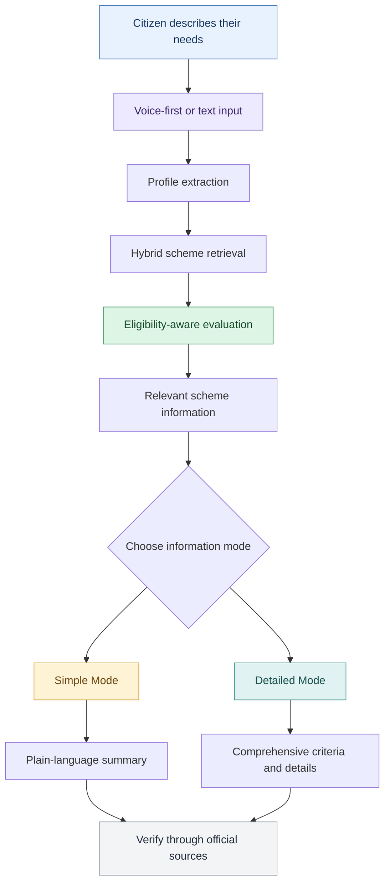
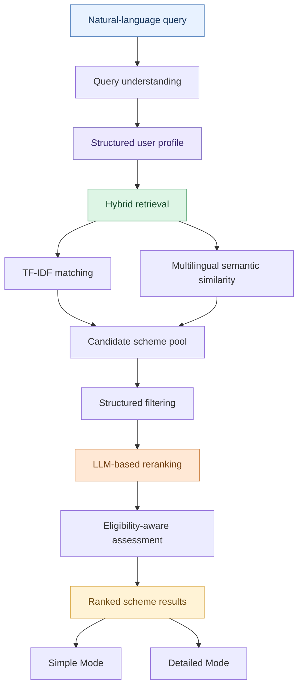

# SuvidhaAI — Making Government Welfare Accessible to Every Citizen

**A voice-first, AI-powered platform for discovering Indian government welfare schemes, designed with rural accessibility and two levels of information: Simple Mode and Detailed Mode.**

**Frontend:** https://suvidha-ai-two.vercel.app/  
**Repository:** https://github.com/parineetarao/suvidha-ai  
**Backend:** Under development for deployment

---

## 1. Problem Statement

India has an extensive network of government welfare programmes covering healthcare, education, agriculture, financial assistance, pensions, and social security. However, discovering the right scheme and understanding its eligibility requirements can be challenging, particularly for citizens who face language, literacy, or digital-navigation barriers.

The challenge is not simply whether information exists online. Citizens must also be able to find, understand, and interpret that information in the context of their own circumstances.

### The digital accessibility gap

India's Ministry of Statistics and Programme Implementation (MoSPI), through its **Comprehensive Modular Survey: Telecom 2025**, reported the following findings for people aged 15 and above:

| Indicator | Rural | Urban |
|---|---:|---:|
| Internet use among males | 72.1% | 85.5% |
| Internet use among females | 57.6% | 74.0% |
| Households with internet access on the premises | 83.3% | 91.6% |

Source: [Press Information Bureau — Results of Comprehensive Modular Survey: Telecom, 2025](https://www.pib.gov.in/Pressreleaseshare.aspx?PRID=2132330&lang=2&reg=48), published 29 May 2025. Internet use refers to accessing the internet at least once during the preceding three months.

These figures highlight differences in internet use between rural and urban populations, alongside a substantial gender gap in both settings. Household connectivity also does not necessarily mean that every household member has independent access, digital skills, or the confidence to navigate complex online services.

### Why welfare discovery needs a different approach

- **Complex eligibility criteria:** Scheme requirements may depend on age, income, occupation, location, social category, disability, or other circumstances.
- **Information overload:** Citizens may have to navigate multiple websites and lengthy descriptions to identify relevant benefits.
- **Language and comprehension barriers:** Administrative terminology and text-heavy interfaces can make information harder to understand.
- **Digital-navigation barriers:** A conventional search interface may expect users to know what to search for and how to interpret the results.
- **Personalized discovery:** A list of schemes is not enough; users need to understand why a scheme may be relevant to them and what requirements they should verify.

**The core problem:** Government welfare information may be available digitally, but finding and understanding the schemes relevant to an individual's circumstances can still require considerable effort.

---

## 2. Proposed Solution

SuvidhaAI proposes a more accessible approach to welfare discovery through a **voice-first interface, multilingual-oriented interaction, and two information modes tailored to different levels of user familiarity**.

Instead of requiring citizens to navigate complicated forms or understand official terminology before searching, the platform is designed to let them describe their circumstances in everyday language.

For example, a user could ask:

> “I am a farmer from Maharashtra. My income is limited, and I want to know what government schemes might help me.”

SuvidhaAI's intended discovery workflow extracts relevant profile information, retrieves candidate schemes, and evaluates them against the available eligibility criteria.

The results can then be explored in either Simple Mode or Detailed Mode.

### Who is SuvidhaAI designed to help?

- Rural citizens who need a more approachable way to navigate welfare information.
- Farmers looking for potentially relevant agricultural or financial assistance.
- Women, widows, senior citizens, students, and other groups who may qualify for specific benefits.
- Users who prefer interacting in a familiar language rather than navigating English-heavy administrative content.
- Citizens who want a concise explanation first, with the option to examine the full eligibility requirements.

SuvidhaAI is intended to reduce the effort involved in discovering relevant schemes. It does not replace government verification, official application portals, or eligibility decisions made by the responsible authorities.

---

## 3. Core Experience: Voice-First and Dual-Mode

### Voice-first interaction

Voice is a central accessibility approach, not a separate information mode. The goal is to let users describe their needs conversationally rather than having to formulate precise search queries or complete lengthy forms.

The intended interaction flow is:

1. The user speaks a query.
2. Speech is converted into text through the configured speech-recognition component.
3. The system identifies relevant personal and socioeconomic attributes.
4. Candidate schemes are retrieved and evaluated.
5. The user explores the resulting information in Simple Mode or Detailed Mode.

This approach is particularly relevant for users who are more comfortable speaking than typing or interpreting long text-based forms.

Voice interaction alone does not eliminate every accessibility barrier. Effective rural use also depends on language accuracy, device access, connectivity, readable results, and clear feedback when speech is not understood.

### Simple Mode — Understand the Essentials

Simple Mode is designed for users who want to understand the main points without navigating lengthy administrative descriptions.

It prioritizes:

- Plain, accessible language.
- A concise explanation of what a scheme offers.
- The main eligibility conditions.
- A clear explanation of why the scheme may be relevant to the user.
- The next steps or official source to consult, where available.

**Example:** Instead of presenting a dense eligibility paragraph, Simple Mode would explain the key requirements in straightforward language and highlight what the user should check.

### Detailed Mode — Explore the Full Information

Detailed Mode is designed for users who want more comprehensive information before deciding whether to pursue a scheme.

It prioritizes:

- Detailed eligibility conditions.
- Relevant income, age, occupation, location, or category requirements.
- Benefits and scheme-specific conditions available in the source data.
- Required documentation and application information, where available.
- Official references for verifying the requirements.

**Example:** A farmer who first learns that a scheme may be relevant in Simple Mode can use Detailed Mode to examine the eligibility conditions and other available scheme information.

### How the two modes work together

Simple Mode and Detailed Mode are **two levels of information presentation**, not two separate search methods.



---

## 4. How the AI Discovery Pipeline Works

SuvidhaAI combines profile extraction, hybrid information retrieval, and LLM-based reasoning to identify potentially relevant schemes.



### Processing stages

1. **Query understanding:** prepares the user's natural-language input for processing.
2. **Profile extraction:** identifies attributes such as age, state, occupation, annual income, and relevant personal circumstances.
3. **Hybrid retrieval:** combines lexical matching with semantic similarity to find candidate schemes.
4. **Structured filtering:** applies supported constraints using available profile attributes and scheme information.
5. **LLM-based reranking:** evaluates the relevance of candidate schemes against the user's circumstances and the available criteria.
6. **Information presentation:** makes scheme information available for exploration through the two presentation modes.

### Hybrid retrieval

The retrieval component combines two complementary techniques:

- **TF-IDF:** identifies lexical overlap between the query and scheme descriptions.
- **Multilingual sentence embeddings:** identifies semantic similarity even when the user's wording differs from the wording used in scheme descriptions.

The project uses `paraphrase-multilingual-MiniLM-L12-v2` for semantic representation.

### Eligibility-aware reasoning

Retrieval identifies potentially relevant candidates; it does not establish eligibility by itself. The LLM-based component is intended to evaluate candidates using the extracted profile and available eligibility information.

The quality of the results depends on the completeness of the scheme data, the accuracy of profile extraction, the retrieval results, and the reliability of the reasoning process.

---

## 5. Technology Stack

| Layer | Technologies | Role |
|---|---|---|
| Frontend | Next.js, React, TypeScript | User-facing application |
| Styling | Tailwind CSS | Responsive interface and visual consistency |
| Backend API | Python, FastAPI | API and scheme-discovery workflows |
| Database | PostgreSQL | Structured scheme and eligibility data |
| Supporting infrastructure | Redis | Caching and supporting workflows |
| Lexical retrieval | TF-IDF | Term-based candidate retrieval |
| Semantic retrieval | Sentence Transformers | Multilingual semantic matching |
| Embedding model | `paraphrase-multilingual-MiniLM-L12-v2` | Semantic representation of queries and scheme text |
| AI reasoning | LLM-based reranking | Candidate evaluation and eligibility-aware reasoning |
| Speech processing | Whisper / faster-whisper components | Speech-recognition workflow |
| Authentication components | JWT, SMS OTP | Authentication-related functionality |

The table describes the project's technology components; it does not imply that all components have been deployed or validated end to end.

---

## 6. Scheme Dataset

The current backend dataset contains **442 government schemes**, of which **434 have non-empty eligibility text**.

Eligibility text is an important input for assessing whether a scheme may be relevant to a user. Missing, outdated, or incomplete information can affect recommendation quality.

The number of schemes in the dataset should not be interpreted as comprehensive coverage of every central and state government welfare programme.

---

## 7. Interface and Interaction Design

The interface should make welfare discovery approachable, especially for people who may be unfamiliar with digital government services.

### Design principles

- **Clear hierarchy:** make the main discovery action immediately understandable.
- **Accessible language:** avoid unnecessary technical terminology in user-facing explanations.
- **Mode clarity:** distinguish Simple Mode from Detailed Mode without creating two disconnected workflows.
- **Visible feedback:** clearly communicate when voice input is active, when a query is processing, and when results are ready.
- **Readable results:** organize scheme information so users can scan summaries before examining detailed requirements.
- **Responsive layout:** support different screen sizes, including mobile devices.
- **Accessible interaction:** maintain sufficient contrast, keyboard access, and support for reduced-motion preferences.

### Motion and animations

Animations can improve feedback when they communicate a meaningful state change.

| Interface element | Suggested motion | Purpose |
|---|---|---|
| Landing page | Subtle fade-in | Introduce the main action without distraction |
| Voice control | Listening indicator or waveform | Show when voice input is active |
| Processing state | Lightweight progress animation | Communicate that the query is being processed |
| Mode switch | Short transition | Make the change between Simple and Detailed Mode clear |
| Scheme results | Subtle staggered entrance | Help users follow the result list |
| Expandable details | Smooth height transition | Reveal additional eligibility information |
| Interactive controls | Restrained hover and press feedback | Improve usability |

Animations should remain lightweight, should not delay access to scheme information, and should respect reduced-motion preferences.

---

## 8. Running the Project Locally

### Prerequisites

- Node.js and npm
- Python version compatible with the backend dependencies
- PostgreSQL
- Redis, if required by the selected backend workflow
- API credentials for external AI services used by the backend

### Clone the repository

```bash
git clone https://github.com/parineetarao/suvidha-ai.git
cd suvidha-ai
```

### Run the frontend

```bash
cd frontend
npm install
npm run dev
```

Open the local URL printed by Next.js, commonly `http://localhost:3000`.

Check the frontend's `package.json` for the available scripts.

### Run the backend locally

The backend has **not yet been deployed publicly**. To run it locally, install the dependencies from the backend's dependency file, configure the database and required environment variables, and start the FastAPI application using its actual entry-point module.

For example, if the application entry point is `app.main:app`:

```bash
pip install -r requirements.txt
uvicorn app.main:app --reload --port 8001
```

When the service is running and the routes are registered, FastAPI documentation may be available at `http://127.0.0.1:8001/docs`.

The commands above are examples; use the actual paths and configuration in the repository.

**Deployment status:** the frontend deployment URL is a placeholder until the frontend is deployed. The backend is not yet publicly deployed, so public end-to-end scheme discovery should not be assumed to be available.

---

## 9. API Overview

The backend includes a smart-search endpoint:

`POST /api/v1/schemes/smart-search`

Example request:

```json
{
  "query": "I am a farmer in Gujarat with an annual income of 100000",
  "language": "en",
  "limit": 10
}
```

The endpoint is intended to process a natural-language query and return scheme matches. Its actual response structure and supported parameters should be verified using the locally running API documentation.

This endpoint is not currently a publicly deployed service.

---

## 10. Responsible Use and Limitations

SuvidhaAI is an independent welfare-discovery project, not an official government portal.

- Recommendations are informational and do not guarantee eligibility.
- Users should verify eligibility, documentation, deadlines, and application procedures through the relevant official government sources.
- Scheme data may be incomplete or outdated.
- Speech-recognition quality can vary by language, accent, background noise, and recording conditions.
- Multilingual components do not guarantee that every feature works equally well in every supported language.
- Personal information should be handled carefully, with appropriate protection for credentials and sensitive data.

The platform is intended to help users navigate information, not to replace official verification or application procedures.

---

## 11. Future Development

Potential improvements include:

- Deploying the backend and connecting it to the public frontend.
- Validating the complete voice-to-recommendation workflow.
- Testing Simple Mode and Detailed Mode with users who have different levels of digital familiarity.
- Improving multilingual speech recognition and retrieval quality.
- Providing official scheme links and clearer source attribution for recommendations.
- Improving explanations of eligibility requirements and missing information.
- Testing usability, accessibility, and performance on lower-end mobile devices and slower connections.

These items are future development goals unless explicitly implemented and verified in the current application.

---

## References

1. **Ministry of Statistics and Programme Implementation, Government of India.** *Results of Comprehensive Modular Survey: Telecom, 2025.* Published 29 May 2025.  
   https://www.pib.gov.in/Pressreleaseshare.aspx?PRID=2132330&lang=2&reg=48

2. **SuvidhaAI source repository.**  
   https://github.com/parineetarao/suvidha-ai

---

**SuvidhaAI's objective is to make welfare information easier to discover and understand: voice-first interaction for accessibility, Simple Mode for clarity, and Detailed Mode for users who need the full picture.**